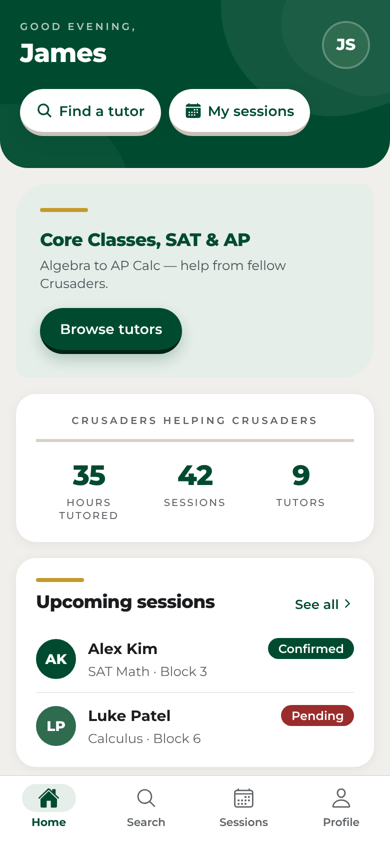
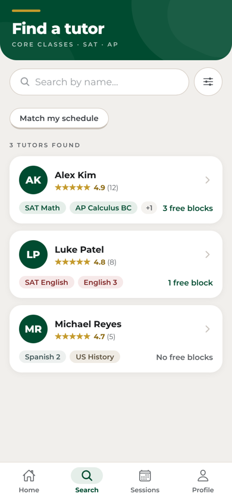
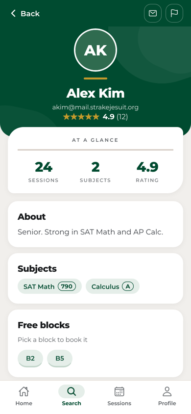
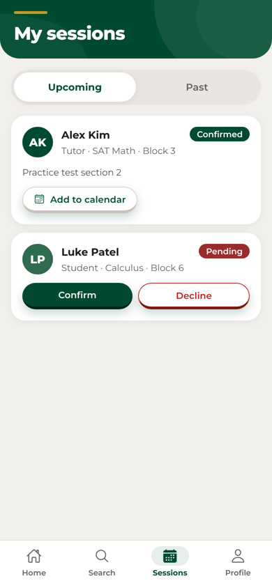
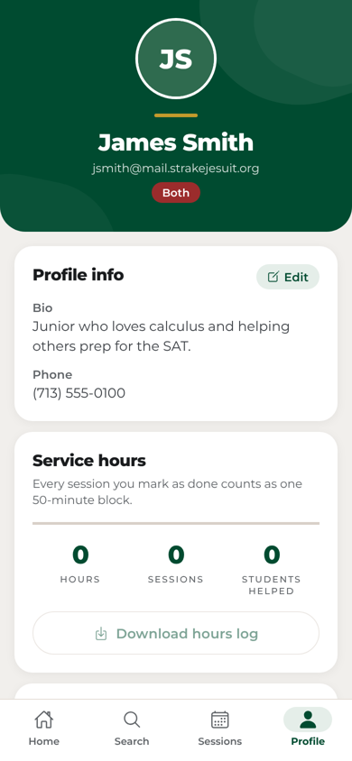

# Strake Jesuit Tutors

**Peer tutoring that fits a block schedule.** Students find a classmate who has
already aced the class, book one of the blocks they're both free, and tutors
earn verifiable service hours for every session they finish.

Built with React Native (Expo), so one codebase runs as an **iPhone / Android
app** and as a **website**.

| Home | Find a tutor | Tutor profile | Sessions | Profile & hours |
|---|---|---|---|---|
|  |  |  |  |  |

## The problem

Students who need help usually ask a friend, wait for office hours, or pay for
outside tutoring. Strong students who want to help (and who often need
volunteer or NHS hours) have no easy way to be found. And on a rotating block
schedule, "when are we both free?" takes a dozen texts.

## What it does

- **Find a tutor** by name, subject (core classes, SAT and AP) or block, or tap
  **Match my schedule** to rank tutors who are free when you are.
- **Book a free block** and add a note. The tutor confirms or declines.
- **Reminders** 10 minutes before a confirmed block, plus *Add to calendar*.
- **Service-hours log**: every session a tutor marks as done counts as one
  50-minute block; tutors download a CSV a moderator can check and sign.
- **Real scheduling**: pick an actual school day and block; nobody can be
  double-booked, and only the tutor can confirm or mark a session done
  (on or after its date). All enforced in the database, not just the app.
- **In-app messages** on every session, live, so nobody shares a phone
  number or email. Reported chats can be read by a moderator.
- **Push notifications** for new requests, confirmations, cancellations
  and messages.
- **Moderator tools** for teachers: verify service hours (so the log is
  official) and review reports.
- **Reviews** after a session, so the best tutors rise to the top.
- **Safety and privacy for minors**: school-email sign-up only, report and
  block on every profile, email addresses never shown (students tap
  *Message*), and phone numbers private unless the owner opts in.
- **Guided start**: a three-step setup with Ollie, then a *Get started*
  checklist (add your classes or free blocks, invite a friend, host or book
  your first session).
- **Ollie the owl** guides new users through a three-step welcome tour.
- **Feels like a real app**: confetti when a session is confirmed or done,
  tutor badges (Top tutor, 10+ hours), pull to refresh, loading placeholders,
  haptic feedback, and a full **dark mode** that follows your phone.

## How it works

```
 iPhone / Android / Web  (Expo · React Native · React Navigation · Zustand)
            │
            ▼
 Supabase ─ Auth (school-email only)
          ├ Postgres + Row-Level Security on every table
          ├ search_tutors(): fuzzy name search + subject/block filters,
          │                     ranked by rating and shared free blocks
          ├ community_stats(): school-wide totals only (no personal rows)
          └ Storage: profile photos
```

- **Matching on a block schedule.** Tutors and students each mark the blocks
  (B1–B8, plus Community Time, CT) they're free. `search_tutors` gives every tutor one score: how well
  the name matches, plus their rating and experience, plus a boost for every
  free block they share with the student. Blocked users are left out both
  ways. The top result is a good tutor you can actually meet.
- **Privacy by default.** Row-level security means a student can only read and
  change their own sessions and chats. Phone numbers can't be read from the
  profiles table at all; a tutor's number is only handed out when they
  switch on "Show my phone number". Reviews can only come from the student
  of a completed session. Anyone can delete their account and everything
  tied to it from Profile. The Home impact numbers come from a
  `security definer` function that returns aggregate counts only.
- **One design system.** Colours, type scale, spacing and the raised 3D
  buttons live in `src/theme/`; every screen is built from the shared
  components in `src/components/ui/`. Re-skinning for another school means
  editing `src/theme/school.js` and `src/theme/colors.js`.

More detail: [ARCHITECTURE.md](ARCHITECTURE.md) · database:
[supabase/migrations](supabase/migrations).

## Quality

- **Unit tests** (Jest + Testing Library): service hours, schedule maths,
  reminders and core components: `npm test`.
- **Screen tests** with Playwright against the web build: 123 checks that
  press every screen's buttons and check what the app sends
  (`npm run test:e2e`, in [e2e/](e2e/)).
- **Database tests**: every migration is applied twice to a real Postgres,
  the demo data is loaded twice, then 50 checks sign in as a tutor, a
  student, a moderator, an outsider and a visitor and try everything they
  should and shouldn't be able to do (`npm run test:db`, in
  [supabase/tests/](supabase/tests/)).
- **CI** on every push runs all of it, plus the web and iOS bundles
  ([.github/workflows/ci.yml](.github/workflows/ci.yml)).
- **Accessibility**: screen-reader labels and roles on every control, Reduce
  Motion respected, and an axe-core (WCAG 2 AA) scan with no violations in
  both light and dark mode.

## Run it

```bash
npm install
npm test               # unit tests
npx expo export --platform web --output-dir dist && npm run test:e2e   # screen tests
PGHOST=localhost PGUSER=postgres npm run test:db                       # database tests
npx expo start         # scan the QR code with Expo Go on your phone
npx expo start --web   # or open it in the browser
```

### Database (Supabase)

Every table, rule and function the app uses is in
[supabase/migrations](supabase/migrations). In your project's **SQL Editor**,
run them in order (each one is safe to run again):

1. `001_initial_schema.sql`: profiles, subjects, free blocks, sessions,
   reviews, reports, blocks, profile photos and tutor search
2. `002_scheduling_messages_moderation.sql`: real session dates,
   double-booking protection, in-app messages, push notifications,
   moderator tools
3. `003_privacy_reviews_accounts.sql`: private phone numbers, reviews only
   from real sessions, account deletion
4. `004_community_time.sql`: Community Time (CT, 9:10–9:50 on weekdays)
   as a free block
5. `supabase/seed_demo.sql` *(optional)*: demo accounts, all with password
   `DemoTutor2026!`. Sign in as `james.smith.demo@mail.strakejesuit.org`
   (student), `alex.kim.demo@…` (tutor) or `mr.thompson.demo@…` (moderator).

Shortcut: `supabase/all_migrations.sql` has 001–004 in one file to paste and
run (rebuild it with `npm run db:bundle` after changing a migration).

Or with the Supabase CLI: `npx supabase link --project-ref <your ref>`, then
`npx supabase db push`.

Make a real teacher a moderator:

```sql
update public.profiles set is_moderator = true where email = 'teacher@mail.strakejesuit.org';
```

Then put the project URL and anon key in `src/lib/supabase.js`.

### Push notifications

Notifications are sent by the database itself (Expo push via `pg_net`). Phones
can only register once the app is linked to an Expo project: run
`npx eas init`, which fills in `extra.eas.projectId` in `app.json`.

## Built with

React Native · Expo SDK 51 · JavaScript · Supabase (Postgres, Auth, Storage) ·
React Navigation · Zustand · React Hook Form + Zod · react-native-svg ·
expo-notifications · Jest · Playwright · Vercel
